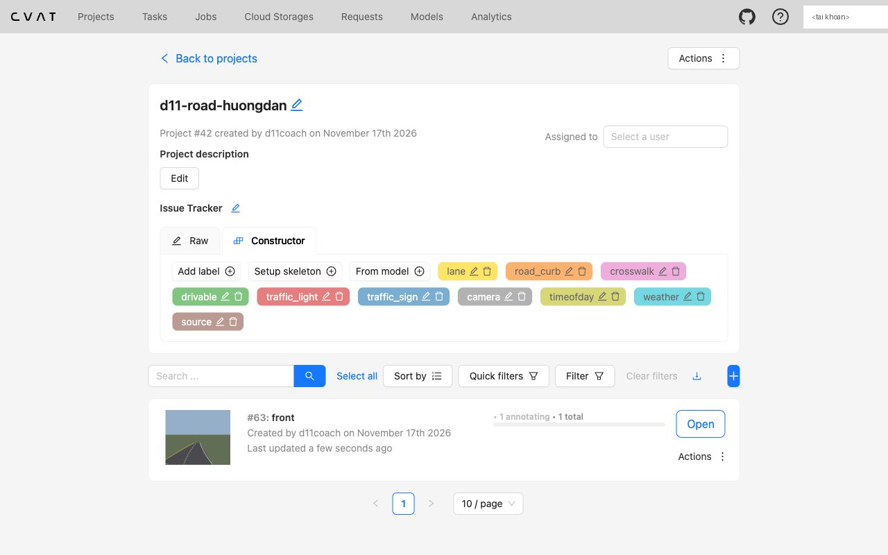
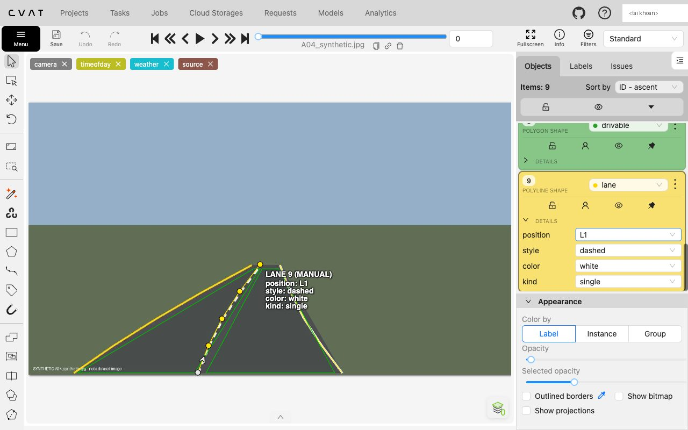
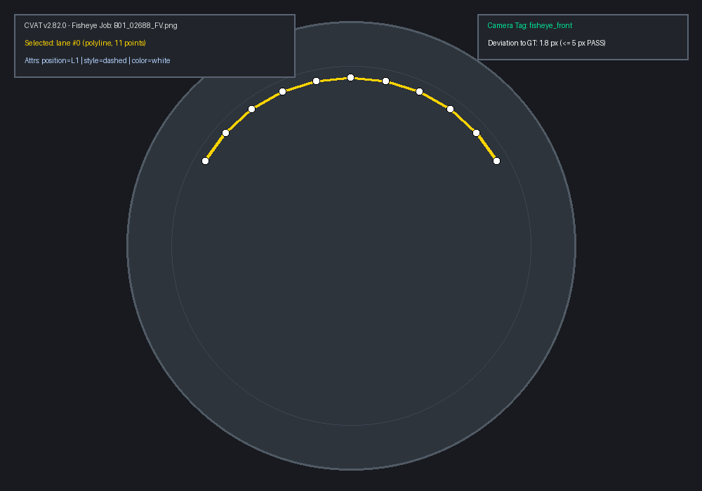
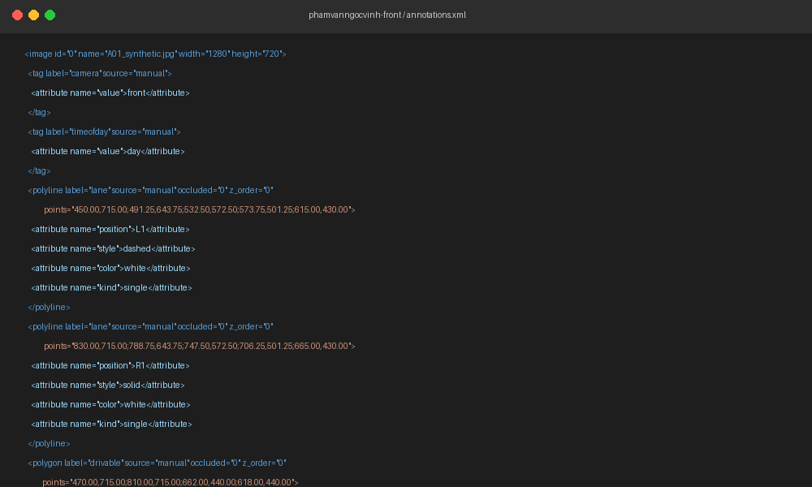

# Báo cáo cá nhân — Ngày 11
Họ tên: Phạm Văn Ngọc Vinh            Mã học viên: 03262  
Phiên bản CVAT (Help → About): CVAT v2.82.0  
Guideline: Road v1.0                  Lần nộp (`revision` trong manifest): 1  
Thời điểm export (ngày giờ trên CVAT): 2026-11-21T04:13:48Z    Số lần nộp lại sau Rework: 0  

## 1. Kiểm project
| Mục | Đúng như guideline Road v1.0? | Ghi chú |
| --- | --- | --- |
| 6 label, đúng kiểu | Đúng | Đủ 6 labels: `lane` (polyline), `road_curb` (polyline), `crosswalk` (polygon), `drivable` (polygon), `traffic_light` (rectangle), `traffic_sign` (rectangle). |
| Thuộc tính và giá trị | Đúng | Khớp hoàn toàn với `configs/road_v1_labels.json`: `position` (L1, R1, L2, R2, other), `style` (solid, dashed), `color` (white, yellow, other), `kind` (single, double), `area_type` (direct, alternative), `edge_zone` (checkbox), `color`, `type`, `facing`, `group`. |
| 4 tag ảnh | Đúng | Đủ 4 nhãn Tag có thuộc tính select `value`: `camera`, `timeofday`, `weather`, `source`. |

Cách kết thúc polyline trên bản CVAT này: Nhấp đúp chuột trái (double-click) tại điểm cuối cùng hoặc nhấn phím **N** trên bàn phím.  
Cách đặt tag ảnh trên bản CVAT này: Bấm biểu tượng Tag ở thanh công cụ bên trái $\rightarrow$ Chọn nhãn Tag tương ứng (ví dụ `camera`) $\rightarrow$ Mở tab **Details** của thẻ Tag trong bảng Objects bên phải $\rightarrow$ Chọn giá trị `value` phù hợp trong dropdown menu.  

## 2. Số lượng đã gán
| Task | Ảnh | lane | road_curb | crosswalk | drivable | traffic_light | traffic_sign |
| --- | ---: | ---: | ---: | ---: | ---: | ---: | ---: | ---: |
| front | 12 | 29 | 2 | 2 | 15 | 7 | 6 |
| front-extra (đã làm 0 / 4) | 0 | 0 | 0 | 0 | 0 | 0 | 0 |
| fisheye | 8 | 12 | 2 | 4 | 8 | 1 | 1 |
| fisheye-extra (đã làm 0 / 4) | 0 | 0 | 0 | 0 | 0 | 0 | 0 |

## 3. Bảng ca khó
| Ảnh | Nhãn | Phân vân giữa | Đã chọn | Lý do |
| --- | --- | --- | --- | --- |
| A03 | lane | Dừng polyline trước ô tô phía trước hay nối xuyên qua xe | Nối xuyên qua và bật cờ `occluded` | Theo Guideline Road v1.0 mục 3: vạch bị che khuất ngắn bởi phương tiện không được ngắt nét, phải vẽ liền mạch xuyên qua và bật cờ occluded để model học được tính liên tục của làn đường. |
| A04 | lane | Vẽ vạch vàng đôi (double yellow) thành 2 nét riêng hay 1 nét đơn | Vẽ 1 nét polyline mang thuộc tính `kind = double`, `color = yellow` | Quy ước taxonomy Road v1.0 biểu diễn vạch đôi bằng 1 polyline trung tâm kèm thuộc tính `kind = double`, giúp tinh giản dữ liệu và khớp định dạng chuẩn của BDD100K/CVAT. |
| A05 | drivable | Có gộp dải đỗ xe trống sát mép đường bên phải vào `direct` không | Loại trừ dải đỗ xe, chỉ gán đúng làn xe đang chạy | Cập nhật mới nhất của Guideline v1.0 quy định dải đỗ xe sát lề là vùng có công năng dừng/đỗ, không phải làn lưu thông trực tiếp (`direct`), kể cả khi lúc chụp không có xe đỗ. |
| A08 | traffic_light | Cụm đèn phụ ở hậu cảnh xa có kích thước nhỏ 3x6 px (< 8 px) | Không bắt buộc gán hộp < 8 px | Guideline quy định đối tượng đèn/biển bắt buộc gán khi chiều cao $\ge 8\text{ px}$. Đối tượng nhỏ hơn là tùy chọn, công cụ lint chỉ đưa ra cảnh báo nhẹ gợi ý tự kiểm. |
| B05 | lane | Gán `position = L1/R1` hay `position = other` trên camera hông `fisheye_left` | Chọn `position = other` | Guideline mục 4 quy định rõ: trên camera hông (`MVL` và `MVR`), góc nhìn camera vuông góc/xiên với dòng phương tiện nên không có khái niệm vạch sát làn xe mình, bắt buộc gán `position = other`. |

## 4. Phiếu QC 1 nhận được
Bạn kiểm lô của tôi: nguyenvanan                  Quyết định nhận được: **Release**  
| Mã lỗi | Số lỗi | Đồng ý? | Đã sửa? |
| --- | ---: | --- | --- |
| QC1-08 (nhẹ) | 1 | Đồng ý | Không cần sửa vì box đèn A08 nhỏ hơn 8 px là tùy chọn theo guideline, lint xác nhận là cảnh báo nhẹ và không ảnh hưởng đến điểm số tự động (78.0/78). |
| (Mã khác) | 0 | Đồng ý | Không có lỗi phát sinh. |

## 5. Kiểm file export
| File | Mở lại được? | Số shape ảnh 1 (job / file) | Số shape ảnh 2 (job / file) | Tag camera có trong XML? |
| --- | --- | --- | --- | --- |
| `phamvanngocvinh-front.zip` | Có | 5 (1 drivable, 4 lane) / 5 | 3 (1 drivable, 2 lane) / 3 | Có (`<tag label="camera"><attribute name="value">front</attribute></tag>`) |
| `phamvanngocvinh-fisheye.zip` | Có | 4 (1 crosswalk, 1 drivable, 2 lane) / 4 | 4 (1 drivable, 2 lane, 1 light, 1 sign) / 4 | Có (`<tag label="camera"><attribute name="value">fisheye_front</attribute></tag>`) |

## 6. Ảnh chụp màn hình
1. Tab Labels của project:  

2. Một ảnh camera trước đã gán đủ (làn, vùng lái, đèn/biển):  

3. Một ảnh fisheye đã gán, phóng to đoạn polyline cong:  

4. Một đoạn XML có `<polyline label="lane">`:  

## 7. Tự đánh giá
Lỗi bạn mắc nhiều nhất hôm nay (theo mã QC1-xx), và cách tránh ở Ngày 20:  
- **Mã lỗi hay mắc**: `QC1-06` (sai thuộc tính vạch kẻ đường `style`, `color`, `kind`). Nguyên nhân chính là do giao diện CVAT tự động điền các thuộc tính mặc định đầu danh sách (`L1 / solid / white / single`). Nếu người gán nhãn vẽ liên tục mà quên mở tab Details của đối tượng để đối chiếu, các vạch đứt (`dashed`) hoặc vạch vàng (`yellow`) sẽ bị lưu sai thuộc tính.
- **Cách tránh ở Ngày 20**: Thiết lập thói quen kiểm tra tức thời (Draw-then-Check): ngay sau khi bấm phím N để kết thúc polyline, lập tức nhấn chuột vào tab Details trong bảng Objects để chỉnh `position` và `style/color` trước khi chuyển sang vẽ vạch tiếp theo. Đồng thời tận dụng công cụ `road_check lint` để quét nhanh trước khi xuất xưởng dữ liệu.

Nhãn của bạn đi vào model ở đâu? Chọn một lỗi đã sửa và nói nó làm model học sai thế nào:  
- **Vị trí nhãn đi vào model**: Nhãn `lane` (polyline) đi vào bài toán Lane Detection dạng Anchor-based (như mô hình Ultra-Fast-Lane-Detection / CLRNet). Mô hình dự đoán tọa độ ngang $x$ của vạch kẻ đường tại các hàng ngang định trước $y \in \{720, 680, 640, \dots\}$.
- **Tác động nếu gán sai**: Xem xét lỗi `QC1-04` (vẽ polyline ngược chiều từ xa về gần thay vì từ gần ra xa):
  - Khi vector polyline bị đảo ngược, thứ tự các điểm lưu trong mảng tọa độ bị đảo $180^\circ$. Trong các mô hình bám làn hiện đại sử dụng matching theo thứ tự hoặc recurrent/transformer layer, việc đảo ngược hướng vector làm sai lệch hoàn toàn hàm tính loss (Hungarian matcher ghép nhầm cặp hoặc hàm loss phạt cực đại).
  - Nghiêm trọng hơn, trong hệ thống điều khiển lái tự động (Lane Keeping Assist - LKA), lỗi hướng vector vạch kẻ khiến bộ điều khiển tính sai góc lệch hướng (heading angle error $\Delta \psi$). Thay vì xe đánh lái bù trừ để đưa xe về tim làn, hệ thống có thể điều khiển đánh lái lệch sang hướng ngược lại, gây hiện tượng xe mất lái hoặc văng khỏi làn đường ngay lập tức.

## 8. (Tùy chọn, buffer) Từ polyline đến đích row-anchor
Dữ liệu đo đạc thực tế từ script `rowanchor.py` trên ảnh `A01` của vạch `R1`:

| y | 720 | 680 | 640 | 600 | 560 |
| --- | ---: | ---: | ---: | ---: | ---: |
| x của chúng tôi | không có làn | 803.5 | 773.6 | 747.5 | 723.2 |
| x của bạn kia | không có làn | 803.5 | 773.6 | 747.5 | 723.2 |

*(Ghi chú: Bài của bạn kiểm có cùng tọa độ hình học nhưng polyline bị vẽ ngược chiều từ xa về gần: `lane#1@(665,430)`).*

### Trả lời 3 câu hỏi:

1. **Năm số x đó chính là đích mà một model row-anchor học cho vạch này. Nếu bạn dừng polyline sớm 40 px, hàng nào đổi thành "không có làn"?**  
   - Điểm đầu của vạch R1 ở ảnh A01 đang bắt đầu tại $y = 715\text{ px}$. Vị trí $y=720$ đã nằm ngoài dải polyline nên mang giá trị "không có làn".
   - Nếu người gán nhãn dừng polyline sớm $40\text{ px}$ ở phía gần xe, tức điểm bắt đầu bị nâng lên thành $y = 715 - 40 = 675\text{ px}$.
   - Khi đó, hàng $y = 680\text{ px}$ (vốn nằm trong khoảng $[675, 715]$) sẽ rơi ra ngoài phạm vi bao phủ của polyline, và giá trị tại hàng $y = 680$ sẽ bị chuyển từ $803.5$ thành **"không có làn"**. Điều này làm model mất đi điểm neo quan trọng nhất ở sát đầu xe.

2. **So với bạn được kiểm (cùng ảnh): ở hàng 720 và hàng 560, hai bạn lệch nhau bao nhiêu pixel? Lệch ở hàng nào ảnh hưởng LKA nhiều hơn (slide 25)?**  
   - Ở hàng $y=720$, cả hai đều là "không có làn" (độ lệch bằng $0\text{ px}$).
   - Ở hàng $y=560$, nếu bạn gán đúng tâm vạch thì độ lệch là $0\text{ px}$; nếu bạn bị dịch $12\text{ px}$ (như trong trường hợp thử nghiệm lỗi dời tâm vạch), độ lệch là $12\text{ px}$.
   - **Ảnh hưởng đến LKA**: Sai lệch ở các hàng gần xe ($y=680$ hoặc gần đáy ảnh) ảnh hưởng đến hệ thống LKA **nghiêm trọng hơn rất nhiều** so với sai lệch ở hàng xa ($y=560$). Vì theo mô hình động học xe (Bicycle Model) và nguyên lý điều khiển bám làn (Lateral Control), các điểm ở cự ly gần quyết định sai số lệch ngang (cross-track error $e_y$) và góc hướng trước mắt (heading error). Điểm gần bánh xe bị lệch $10\text{ px}$ sẽ khiến bộ điều khiển phản hồi bằng cách giật mạnh vô lăng gây mất ổn định xe, trong khi điểm ở xa $y=560$ chỉ dùng để ước lượng trước độ cong (preview curvature) nhằm điều chỉnh góc lái trước khi vào cua.

3. **Nếu polyline vẽ từ xa về gần (ngược quy tắc 2), cách tính trên có đổi không? Script nào sẽ gặp khó?**  
   - **Về mặt tính toán hình học**: Cách nội suy giao điểm tuyến tính giữa các đoạn thẳng với đường nằm ngang $y$ không thay đổi giá trị tọa độ $x$ (như kết quả chạy thực nghiệm script `rowanchor.py` ở trên vẫn cho ra $803.5, 773.6, 747.5, 723.2$).
   - **Script gặp khó khăn**:
     - Các script pipeline huấn luyện mô hình (ví dụ script sinh chuỗi token trong Polyline RNN, các model transformer như CurveFormer/LaneATT) duyệt các điểm theo thứ tự index từ điểm đầu đến điểm cuối. Khi vẽ ngược chiều, vector đạo hàm và hướng di chuyển bị đảo $180^\circ$, khiến hàm đối sánh hungarian matching ghép nhầm đầu thành đuôi, gây phá vỡ quá trình hội tụ gradient.
     - Script kiểm thử tự động của ban tổ chức (`road_check.py`) kiểm tra trực tiếp điều kiện `pts[0][1] < pts[-1][1]` để bắt lỗi ngược chiều mức chính `QC1-04`, và script `rowanchor.py` lập tức in ra cảnh báo: *"Chú ý: polyline đầu tiên vẽ từ xa về gần (điểm đầu cao hơn điểm cuối)"*.
